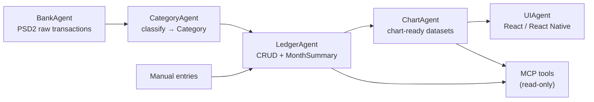
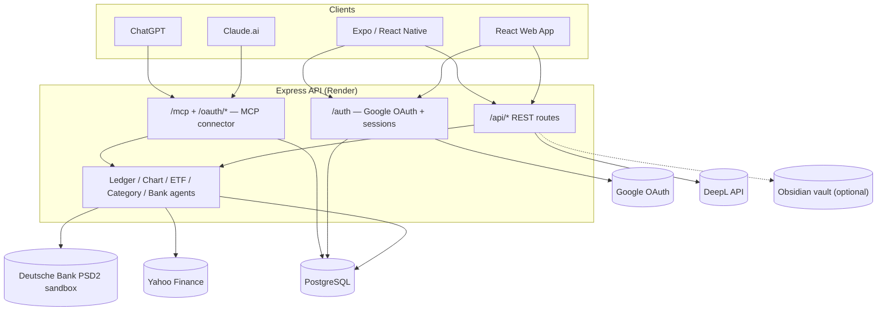
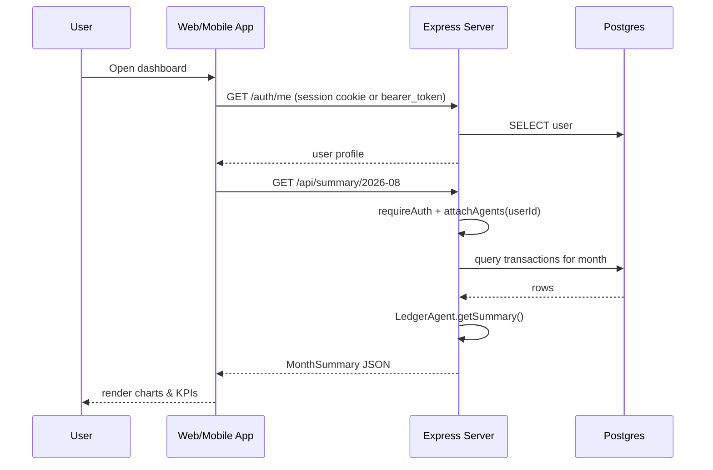
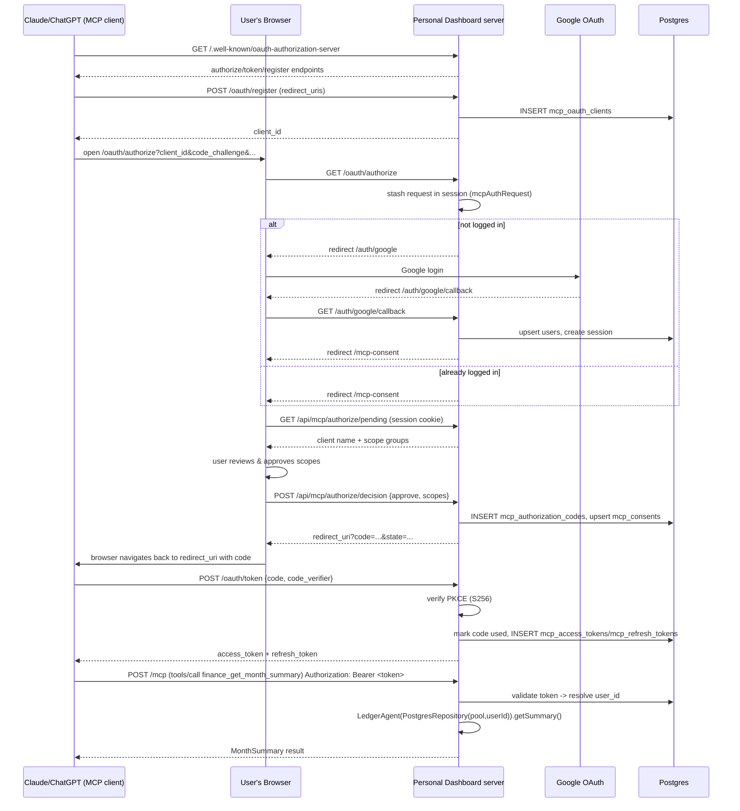

# Architecture

Financial data flows through a small pipeline of single-responsibility agents
(see `.claude/architecture/*.md` for the full spec of each):



Design rules (enforced across the codebase, see `CLAUDE.md`):

- Manual entries satisfy the same `Transaction` interface as bank-sourced ones.
- Categories and chart types extend via config (`categoryMap.ts`, `CAT_COLORS`), not
  by editing classifier/chart logic.
- Each agent depends on interfaces (`TransactionRepository`), not concrete DB code,
  so a Postgres-backed repo can be swapped for an in-memory one in tests.

## System topology



## Sequence diagrams

### A normal authenticated request (web/mobile client)



### Connecting Claude/ChatGPT via MCP (OAuth + first tool call)



## Project structure

```
src/
├── agents/            # BankAgent, CategoryAgent, LedgerAgent, ChartAgent, ETFAgent
├── mcp/               # MCP OAuth server, auth middleware, and tool definitions
│   ├── oauth/         # PKCE, client registration, auth codes, tokens, consent
│   └── tools/         # one file per tool group (finance, notes, language, chains, ...)
├── api/
│   ├── routes/        # one router per feature area (entries, summary, meal, sport, mcp*, ...)
│   └── obsidian/       # optional vault-file backend for Notes
├── auth/              # passport (Google OAuth) configuration
├── db/                # pool.ts, migrate.ts (single idempotent schema blob)
└── types/             # shared Transaction/MonthSummary types, Express augmentation

client/src/            # React web app (tabs/, components/, hooks/, pages/)
mobile/src/            # Expo / React Native app (paused — the PWA covers iPhone/iPad)
.claude/
├── architecture/      # per-agent design docs (BankAgent, LedgerAgent, ChartAgent, ...)
├── agents/            # reviewer sub-agents (e.g. mobile-reviewer.md)
├── tasks/             # backlog.md (planned work)
└── settings.json      # hooks wiring (see "Developing with Claude Code" below)
```

← [Back to README](../README.md)
